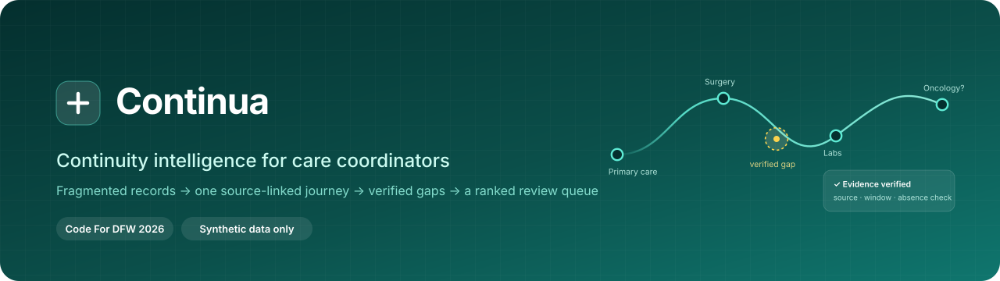
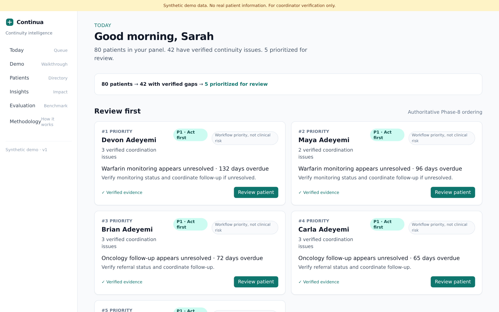
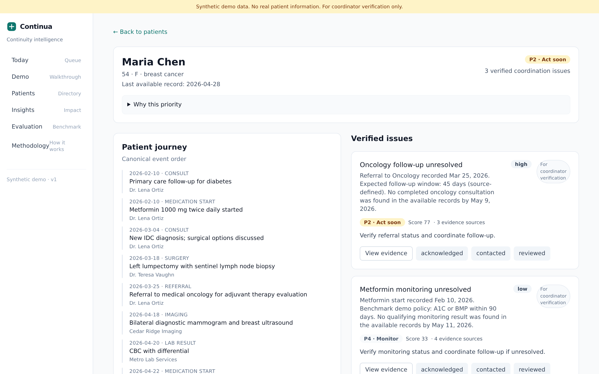
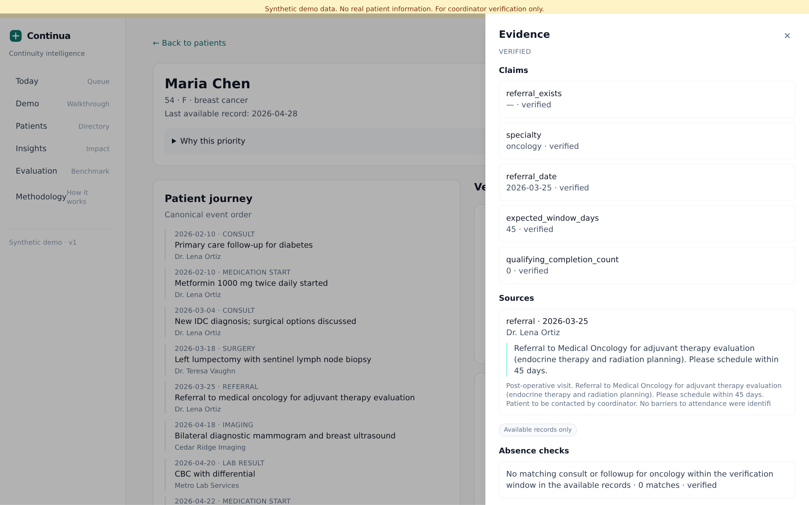
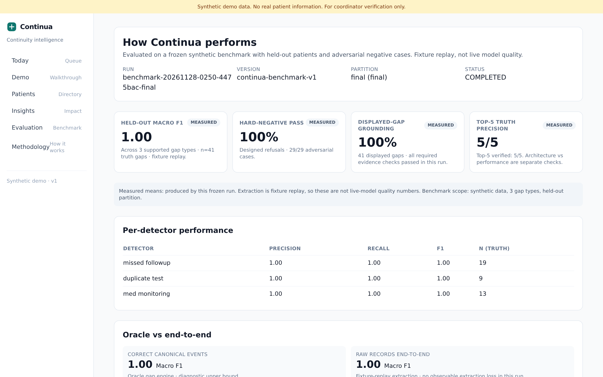
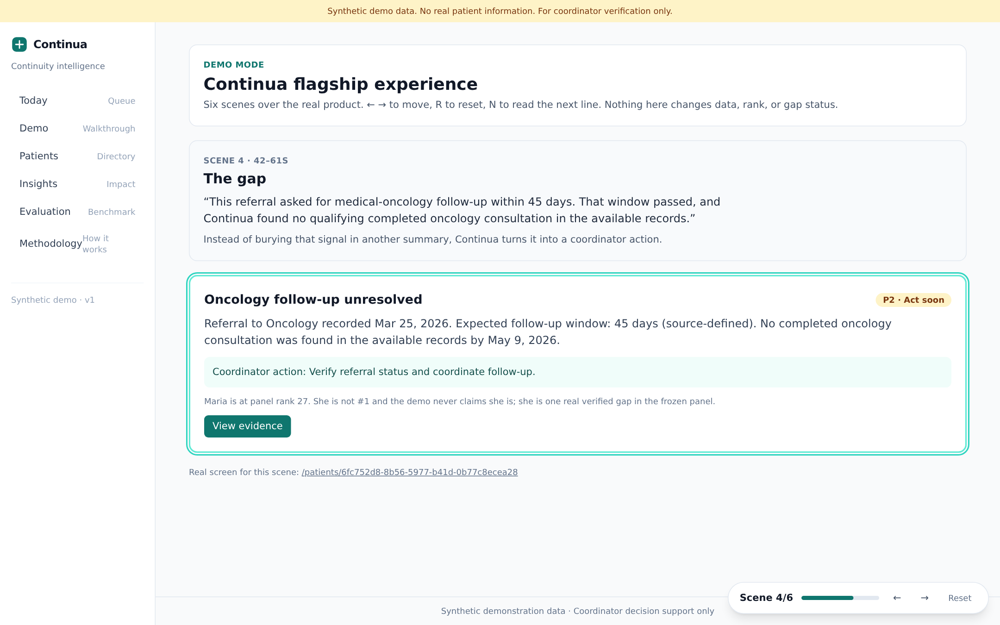
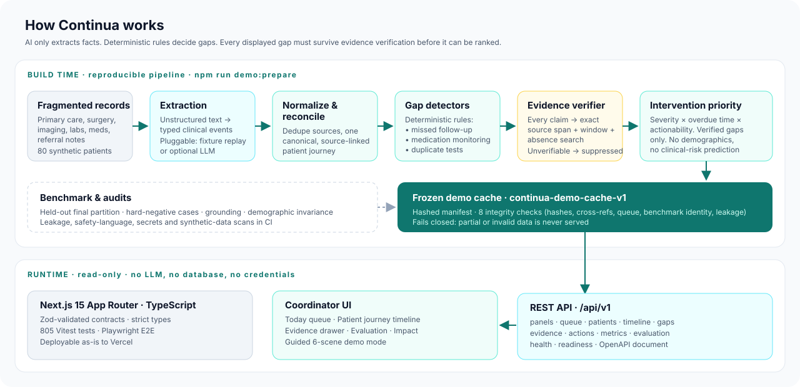

<p align="center">
  
</p>

<p align="center">
  <a href="https://nextjs.org"></a>
  <a href="https://www.typescriptlang.org"></a>
  
  
  
  <a href="LICENSE"></a>
</p>

<p align="center">
  <b><a href="LIVE_DEMO_URL">Live demo</a></b> ·
  <b><a href="VIDEO_URL">Demo video</a></b> ·
  <b><a href="docs/submission/EXECUTIVE_SUMMARY.md">Executive summary</a></b> ·
  <a href="#-quick-start">Run locally</a> ·
  <a href="#-how-it-works">Architecture</a> ·
  <a href="#-results">Results</a>
</p>

---

> **Care coordinators don't lack patient data. They lack time to find what matters across fragmented records.**
>
> Continua rebuilds a patient's scattered records into **one source-linked journey**, finds **continuity gaps** (missed referrals, overdue medication monitoring, duplicate tests), **checks each one against its source evidence**, and gives the coordinator a **ranked review queue**. Every flag on screen comes with proof.

<p align="center">
  
</p>

## 📌 Table of contents

- [The problem](#-the-problem)
- [What Continua does](#-what-continua-does)
- [Product tour](#-product-tour)
- [How it works](#-how-it-works)
- [Results](#-results)
- [Quick start](#-quick-start)
- [Deploy](#-deploy)
- [API](#-api)
- [Tech stack](#-tech-stack)
- [Project structure](#-project-structure)
- [Quality gates](#-quality-gates)
- [Safety and responsible AI](#-safety-and-responsible-ai)
- [Limitations and roadmap](#-limitations-and-roadmap)
- [Hackathon submission](#-hackathon-submission)

## 🩺 The problem

A patient with a new diagnosis touches primary care, a surgeon, an imaging center, a lab and a specialist, often in different systems. Each record is complete on its own. **The gap is between them**, for example:

- A referral to oncology says *"schedule within 45 days."* No visit ever happens, and nobody notices because no single record is wrong.
- Warfarin is started, but the monitoring lab never shows up.
- The same test is repeated eight days apart because the first result was in another system.

A care coordinator responsible for a panel of patients has to find these by hand, chart by chart. Most of that time goes to *searching*, not *acting*.

## ✨ What Continua does

| | Capability | What the coordinator sees |
|---|---|---|
| 🧩 | **Rebuilds the journey** | Records from every source merged into one ordered, de-duplicated timeline. Each event links back to its source document. |
| 🔎 | **Detects continuity gaps** | Three gap types, found by deterministic, auditable rules: **missed follow-up**, **medication monitoring**, **duplicate test**. |
| ✅ | **Verifies every claim** | Each displayed gap has an evidence bundle: the exact source text, the source-defined time window, and a search showing *zero* matching completions. If the evidence can't be verified, the gap is **not shown**. |
| 📊 | **Ranks what to review first** | A transparent intervention-priority score (severity × days overdue × actionability) over *verified* gaps only. It ranks workflow priority, **not** clinical risk. |
| 🧭 | **Turns findings into actions** | Plain-language next steps (*"Verify referral status and coordinate follow-up"*), with acknowledged / contacted / reviewed tracking. |

## 🖥 Product tour

<table>
  <tr>
    <td width="50%"><br/><b>Patient journey.</b> Twelve records from primary care, surgery, imaging, labs and medications rebuilt into one timeline, with verified issues alongside.</td>
    <td width="50%"><br/><b>Evidence drawer.</b> Each claim is verified: the referral, its 45-day window, the source quote, and an absence check with 0 matches.</td>
  </tr>
  <tr>
    <td width="50%"><br/><b>Evaluation.</b> Benchmark results on a held-out patient set, per-detector scores, baseline comparison, and what the benchmark does <i>not</i> prove.</td>
    <td width="50%"><br/><b>Guided demo.</b> A six-scene walkthrough built on the real product screens. Use ← → to move between scenes; it never alters data.</td>
  </tr>
</table>

## 🏗 How it works

<p align="center">
  
</p>

**Design principle: AI extracts facts, rules make decisions.** The language model's job is limited to turning unstructured notes into typed clinical events. Whether a gap *exists* is decided by deterministic, unit-tested rules, so a change to a prompt can never quietly change what counts as a gap ([ADR-001](docs/decisions/ADR-001-hybrid-ai-deterministic-reasoning.md)).

1. **Extraction:** source documents → candidate clinical events, behind a provider-independent interface (fixture replay by default; OpenRouter, Ollama or Gemini optional).
2. **Normalize and reconcile:** de-duplicate across sources into one canonical, provenance-tracked event store.
3. **Detect:** order-independent detectors with frozen thresholds ([detector design](docs/detectors/detector-design.md)).
4. **Verify:** every claim a gap makes must point to evidence, *including absence*. "No oncology consult was found" is only shown after an explicit search of the available records ([evidence model](docs/evidence/evidence-model.md)).
5. **Prioritize:** a deterministic, explainable score over verified gaps. Demographics are excluded and tested for invariance ([priority](docs/architecture/priority.md)).
6. **Freeze and serve:** outputs are written to a hashed, self-validating demo cache. The app serves it through read-only API routes and **fails closed**: if validation fails, no partial data is ever shown.

## 📈 Results

Measured on the frozen benchmark `continua-benchmark-v1`, **held-out final partition**: 60 synthetic patients and 41 truth gaps, including adversarial "hard negative" cases built to trigger false alarms.

| Metric | Result |
|---|---|
| End-to-end macro F1 (3 gap types) | **1.00** |
| Hard-negative pass rate (should say "no") | **29 / 29** |
| Displayed-gap grounding (every claim cites a real source) | **100%** |
| Unsupported claims shown to the coordinator | **0** |
| Top-5 queue: verified and matching ground truth | **5 / 5** |
| Demographic-invariance violations | **0** |
| Cached queue read, p50 | **1.79 ms** |

**Baselines on the same data:** naive keyword rules reach **0.44** macro F1 and pass only 62% of hard negatives.

> **How to read these numbers.** The data is synthetic and the extraction step is *fixture replay*, so these results show that the detection → verification → ranking pipeline is correct. They do **not** measure live-LLM extraction quality or clinical outcomes. The [Evaluation page](docs/evaluation/results.md) and [benchmark card](docs/evaluation/benchmark-card.md) state this alongside the numbers.

## 🚀 Quick start

**Requirements:** Node.js ≥ 20 and npm ≥ 10. No API keys, database or credentials needed.

```bash
git clone https://github.com/bhuwanb23/Continua.git
cd Continua
npm ci
npm run dev
```

Open **http://localhost:3000**. For the guided walkthrough, open **/demo**.

<details>
<summary><b>Production build</b></summary>

```bash
npm run build
npm run start            # http://localhost:3000
```
</details>

<details>
<summary><b>Regenerate the whole pipeline from scratch</b></summary>

The frozen demo cache is committed, so the app works right after cloning. To rebuild every artifact from the synthetic source records:

```bash
npm run generate:data    # deterministic synthetic dataset (byte-identical on re-run)
npm run demo:prepare     # extraction → benchmark → evidence → priority → demo cache
npm run validate         # full quality gate
```
</details>

<details>
<summary><b>Optional: live LLM extraction</b></summary>

Copy `.env.example` to `.env.local` and set `LLM_PROVIDER` (`openrouter` | `ollama` | `gemini`) and `LLM_API_KEY`. Then run:

```bash
npm run run:extraction -- --partition dev --extractor llm
```

The serving path never calls the LLM. Live extraction only feeds the offline pipeline.
</details>

## ☁ Deploy

[](https://vercel.com/new/clone?repository-url=https%3A%2F%2Fgithub.com%2Fbhuwanb23%2FContinua)

No environment variables are required. `vercel.json` and `next.config.ts` already ship the frozen cache with the serverless functions. After deploying, check `/api/v1/readiness`, which should return `200`.

## 🔌 API

Read-only and versioned, with typed errors and request IDs. Full spec: [`docs/api/api-v1.md`](docs/api/api-v1.md) · OpenAPI: `docs/api/openapi.json`.

| Method | Route | Returns |
|---|---|---|
| `GET` | `/api/v1/panels/{panelId}` | Panel summary |
| `GET` | `/api/v1/panels/{panelId}/queue` | Ranked review queue |
| `GET` | `/api/v1/panels/{panelId}/patients` | Patient directory |
| `GET` | `/api/v1/patients/{patientId}` | Patient header and priority |
| `GET` | `/api/v1/patients/{patientId}/timeline` | Reconstructed journey |
| `GET` | `/api/v1/patients/{patientId}/gaps` | Verified gaps |
| `GET` | `/api/v1/evidence/{gapId}` | Evidence bundle for one gap |
| `POST` | `/api/v1/gaps/{gapId}/actions` | Record acknowledged / contacted / reviewed |
| `GET` | `/api/v1/evaluation` · `/api/v1/metrics` | Benchmark report and classified metrics |
| `GET` | `/api/v1/health` · `/api/v1/readiness` | Liveness and cache readiness |

## 🧰 Tech stack

| Layer | Choice | Why |
|---|---|---|
| App | **Next.js 15** (App Router), **React 19**, **TypeScript (strict)** | One codebase for UI and API; easy to deploy anywhere |
| Contracts | **Zod** schemas | Runtime-validated data at every boundary |
| Intelligence | Deterministic detectors, evidence verifier, priority engine | Auditable and reproducible; no black-box decisions |
| AI | Provider-independent extractor (OpenRouter / Ollama / Gemini) | Swappable; AI never decides whether a gap exists |
| Testing | **Vitest** (805 tests), **Playwright** | Unit, contract, integration, reliability, safety and visual tests |
| CI | GitHub Actions | Lint, typecheck, tests, dataset reproducibility, safety and secret scans, build |

## 🗂 Project structure

```
app/            Next.js pages (Today, Patients, Demo, Insights, Evaluation, Methodology) + /api/v1 routes
components/     UI system: queue cards, timeline, evidence drawer, design primitives
lib/            Domain logic
  ├─ extraction/      provider-independent extractor + fixture replay
  ├─ normalization/   reconciliation/  clinical-events/
  ├─ detectors/       missed follow-up · medication monitoring · duplicate test
  ├─ evidence/        claim verification, absence checks, suppression
  ├─ priority/        intervention-priority engine
  ├─ cache/           frozen demo cache builder + fail-closed validator
  └─ safety/  claims/ language guards, approved-claim registry
data/           Synthetic dataset, held-out eval set, frozen demo cache
scripts/        Generation, benchmark, freeze and audit tooling
tests/          805 tests across 165 files
docs/           Architecture, ADRs, evaluation, safety, API, demo, design
```

## ✅ Quality gates

```bash
npm run validate
```

This single command runs lint, typecheck, the full test suite, spec and dataset checks, label-leakage audits, benchmark integrity, the evidence, priority and cache validators, API contract freeze, a safety-language scan, a secret scan, and a synthetic-data scan. CI additionally regenerates the dataset and fails if the bytes differ.

| Command | Purpose |
|---|---|
| `npm run test` | 805 unit / contract / integration tests |
| `npm run test:safety` | Safety and output-language tests |
| `npm run test:reliability` | Fault injection and golden-path regression |
| `npm run benchmark:final` | Re-run the held-out benchmark |
| `npm run demo:check` | Demo readiness check |

## 🛡 Safety and responsible AI

- **Synthetic only.** No real patient information exists anywhere in the repo; a scanner enforces this.
- **Decision support, not diagnosis.** Continua ranks *coordination* work. It does not predict clinical risk, diagnose, or recommend treatment. Output-language guards block clinical-authority phrasing.
- **Evidence or silence.** If a claim can't be traced to a source, the gap is suppressed rather than shown.
- **Fairness by construction.** Demographics are excluded from priority, and an invariance test mutates them to prove the ranking doesn't change.
- **Honest claims.** Every number in the UI comes from a registry that classifies it as *measured*, *modeled* or *assumption* ([approved claims](docs/impact/approved-claims.md)).

See the [system card](docs/safety/system-card.md).

## 🧭 Limitations and roadmap

**Today:** a working prototype on synthetic data. It is not HIPAA-compliant, not clinically validated, and not connected to a real EHR.

**Next:**
- [ ] CSV / PDF referral import so a practice can try it on its own exports
- [ ] FHIR R4 ingestion for EHR integration
- [ ] Live-LLM extraction benchmark against the gold extraction set
- [ ] Coordinator action persistence and team hand-offs
- [ ] Pilot with a DFW practice's care-coordination team under a proper data agreement

## 🏆 Hackathon submission

Built for **[Code For DFW 2026](https://code-for-dfw.devpost.com/)**.

| Deliverable | Link |
|---|---|
| Executive summary | [`docs/submission/EXECUTIVE_SUMMARY.md`](docs/submission/EXECUTIVE_SUMMARY.md) |
| Live demo | LIVE_DEMO_URL |
| Demo video (1–2 min) | VIDEO_URL |
| Run instructions | [Quick start](#-quick-start) |
| Generative AI disclosure | [`AI_DISCLOSURE.md`](AI_DISCLOSURE.md) |

## 📄 License

[MIT](LICENSE) © 2026 bhuwanb23. The synthetic data and code are free to use and build on. Not for clinical use.
